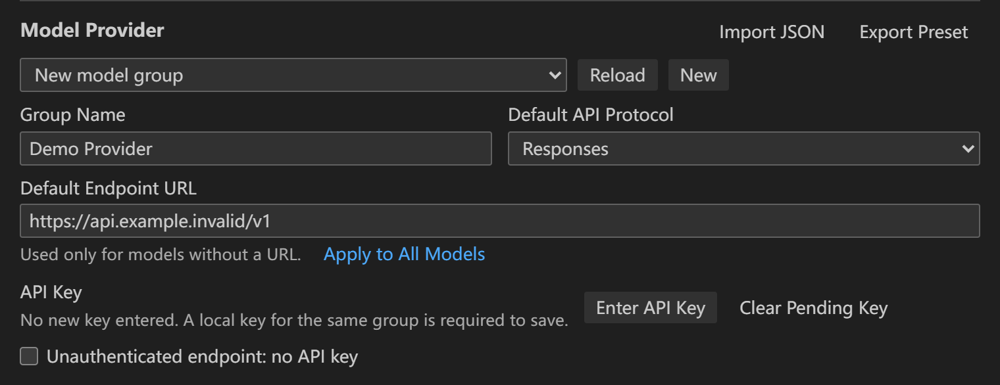
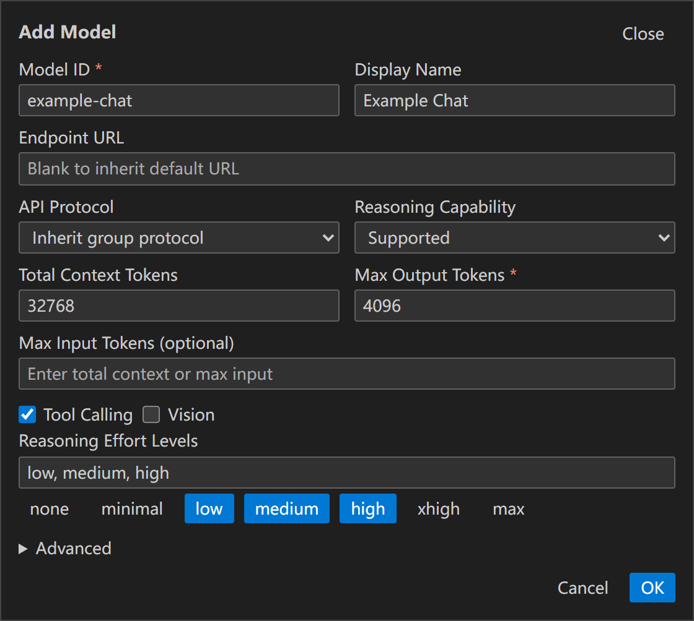
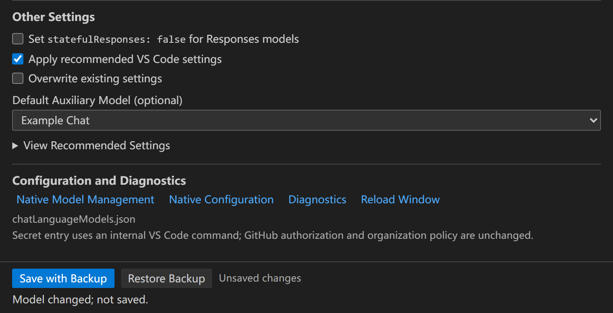

# BYOK Manager

Configure a provider's models in VS Code Chat using your own API key (BYOK). The manager edits the current profile's Custom Endpoint configuration; it does not host models or test your provider. It is independent of Microsoft and GitHub. [简体中文](README.zh-CN.md)

## Quick start: from an endpoint to your first reply

1. **Open the manager.** In VS Code Desktop 1.122 or later, enable official Chat/Copilot with Custom Endpoint support. Use a trusted local window and the profile where you want to chat. Select the **BYOK Manager** key in the Activity Bar → **Open Model Manager**, or run **BYOK: Open Model Manager** from the Command Palette. For guided setup, use VS Code's **Getting Started** walkthrough, **BYOK: Open User Guide**, or **Open User Guide** in the BYOK sidebar. New to Chat? See Microsoft's [Getting Started with Copilot in VS Code](https://code.visualstudio.com/docs/copilot/getting-started).

2. **Set the group and destination.** Choose **New**, select an existing group, or **Import JSON**. **Group Name** identifies the local group, not a provider account. Choose the **Default API Protocol** your provider documents: Chat Completions sends a message history; Responses has a different schema and can continue from a response ID when supported. **Default Endpoint URL** fills only missing model URLs; **Apply to All Models** replaces individual URLs in the draft. Use the inference API, not the Admin console, dashboard, or browser chat page. The manager cannot create provider accounts or keys, grant model access, or change quotas. The validator accepts an absolute HTTP(S) base such as `https://gateway.example/v1`, or a full route ending in `/chat/completions` (Chat Completions), `/responses` (Responses), or `/messages` (Messages). A recognized suffix must match the effective protocol. No URL usernames, passwords, query parameters or fragments. Prefer HTTPS; a parseable URL need not serve a model.

3. **Set the credential.** Select **Enter API Key** and enter a key authorized for inference, not an Admin credential. The masked input holds it in memory until a confirmed save hands it to VS Code's native secret service. With no new key, saving can reuse a local reference for the same group. Choose **Unauthenticated endpoint** only if no key is required. Never paste keys in a URL, model JSON or screenshot.

   

4. **Add one model.** Choose **Add Model**. **Model ID** must match the provider's API ID and be unique in the group. **Display Name** is the label in the picker; blank uses the ID. Leave the model's URL and protocol blank to inherit the group defaults. **Total Context Tokens** is the combined input and output budget; **Max Output Tokens** is the reply ceiling. Enter positive integers: output is required, plus either total context or **Max Input Tokens**. Total context must exceed output; if all three are set, input + output must fit. Use the limits for *this deployment and key*, not an Admin quota or an advertised web-chat limit. Enable **Tool Calling** (structured tool calls) and **Vision** (image input) only if supported. **Reasoning Capability** declares support; **Reasoning Effort Levels** lists the values the API accepts. If unknown, leave reasoning unspecified and levels blank. **OK** updates only the draft.

   

5. **Decide whether to change Chat settings.** Under **Other Settings**, leave **Keep existing model selectors** for a first test; it does not choose the model for your chat. Uncheck **Apply recommended VS Code settings** for a model-only save. If enabled, recommendations propose Agent Host BYOK, use of the main agent model for utility fallback, and request queuing. Existing user settings are preserved unless you select **Overwrite existing settings**; unsupported settings are skipped. See [Auxiliary model](#auxiliary-model) before opting in.

6. **Validate, then save.** **Validate** checks fields, IDs, URLs and token budgets locally; it neither writes nor tests a key, network connection or capability. Choose **Save with Backup**. Check the target profile, group, destinations, credential choice and proposed settings before confirming. Saving first backs up the profile's model file, then writes the group. Updating an existing group replaces its model list, not other groups. Wait for the save result.

   The illustration shows an **optional** auxiliary model. Leave the selector unchanged if you only want to add a Chat model.

   

7. **Test in real Chat.** Open a new VS Code Chat, select the specific model from your group (**not Auto**), and send a short text-only prompt such as “Reply with OK.” This is the first provider request in this procedure; provider charges and policies may apply. A reply tests that text request, not tool calling, vision or every chat mode. Test each feature separately with non-sensitive input.

## Auxiliary model

With recommendations enabled, selecting one model proposes it for four separate jobs. Leave the selector blank if you only want ordinary Chat, already have defaults you like, or have not verified the model's capabilities, latency and cost.

- **Plan Agent** (`chat.planAgent.defaultModel`): the default model for planning work, not the main chat model picker.
- **Inline Chat** (`inlineChat.defaultModel`): the model for conversational edits in the editor.
- **Utility** (`chat.utilityModel`): a model for supporting tasks requested by Chat, separate from the user-facing reply.
- **Utility Small** (`chat.utilitySmallModel`): a model for lighter supporting tasks where a fast, inexpensive model may be preferable.

## Maintaining a group

- **Change the list:** search by name or ID, then edit, copy or delete a row. **Batch Add Model IDs** is useful when models share limits and capabilities. **Append JSON** merges models by ID (skip duplicates unless replacement is selected). Review the draft, validate and save. A group must contain 1–300 models.
- **Move a preset:** **Export Preset** and **Import JSON** handle group configurations; JSON/JSONC imports can also select a group from a whole profile file. Imports and exports strip recognized credential fields and all request headers. Review endpoints and custom fields before sharing; supply credentials locally on the destination machine.
- **Rotate a key or move an endpoint:** select the existing group, enter the replacement key or edit the URL, then check every destination in the save confirmation. Clearing a pending key only discards that draft key; it does not revoke a provider credential. Revoke old keys at the provider after testing the replacement.

## FAQ and recovery

- **401 or 403 in Chat?** For **401**, check the intended endpoint and re-enter a current inference key for that group. For **403**, verify model/deployment access, project permissions and provider or organization policy. Neither a saved secret reference nor an Admin login proves inference access.
- **400 or 429?** For **400**, compare the actual model ID, endpoint path, protocol, token limits and optional request features with the provider's API specification. For **429**, check quota, billing and concurrency; wait for the provider's retry interval before trying again.
- **Text works, but tools or long chats fail?** Tool Calling is a declaration, not an adapter: both the model and gateway must support the protocol's tool requests. Use plain chat or a compatible model. For a context error, start a shorter chat or remove attachments and lower the output budget; raising a field cannot raise the provider's limit.
- **First Responses turn works, follow-up fails?** If the gateway does not support continuing from a previous response, try **Other Settings → Set `statefulResponses: false` for Responses models**, save, and test two turns in a new chat. This applies only to Responses models and depends on provider/VS Code support.
- **Login prompt or missing model?** Confirm the current profile and inspect **Native Model Management**. Save drafts before reloading the window. GitHub sign-in requirements depend on VS Code, chat mode, provider support and organization policy. The manager cannot bypass sign-in, subscriptions or authorization.
- **Need to undo a save?** **Restore Backup** lets you choose a backup for the current profile. It backs up the current file, then replaces the **entire model configuration, including other providers**. It reverts eligible user settings only if they still match what the manager wrote. It does not restore or delete vault entries; re-enter a missing key. Keep backups private: they may contain old plaintext credentials, headers or internal URLs.
- **Cannot save or need help?** If another window edited the configuration, resolve unsaved edits and reload the group before retrying. Run **BYOK: Show Compatibility Diagnostics** from the Command Palette or the sidebar to check the host, provider and native commands. Diagnostics do not call the endpoint. Native key handling relies on internal commands that may change. For support, share versions and a redacted error, not keys, local paths, private endpoints, backups or secret databases.

## Development and license

Node.js 22+ recommended; no runtime dependencies. Run `npm test` and `npm run check`; F5 opens the Extension Development Host. `npm run package:public` creates the generic VSIX in `dist/`. The same source can be built with a privately supplied edition configuration; the public extension never loads a private configuration at startup. See `RELEASE.md` for edition builds and `TESTING.md` for verification. The manager collects no telemetry. MIT; see `LICENSE.txt`.
