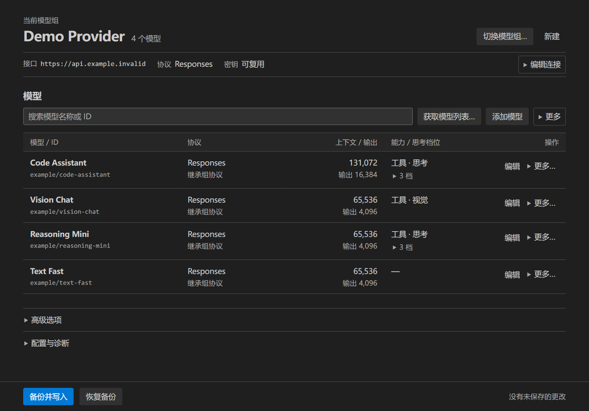
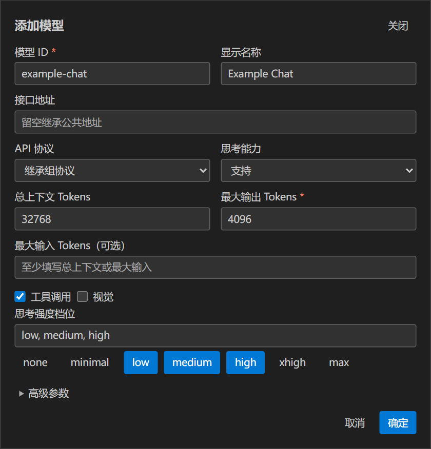
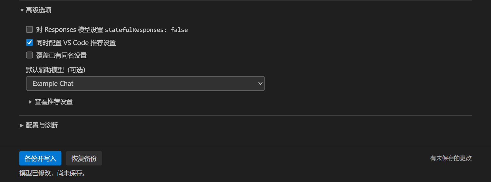

# BYOK Manager

用自己的 API Key（BYOK）把供应商的模型接入 VS Code Chat。管理器编辑当前配置文件（Profile）的 Custom Endpoint 模型组，不托管模型，也不测试供应商接口。本扩展独立于 Microsoft 和 GitHub。[English](README.md)

## 快速开始：从接口地址到第一条回复

1. **打开管理器。** 使用 VS Code 桌面版 1.122 或更新版本，启用支持 Custom Endpoint 的官方 Chat/Copilot。在可信的本地窗口中切换到实际使用 Chat 的 Profile。从活动栏的 **BYOK 管理器**钥匙图标选择**打开模型管理器**，或运行命令 `BYOK: 打开模型管理器`。需要引导时，可打开 VS Code 官方“入门”（Getting Started）中的扩展演练、运行 `BYOK: 使用教程`（英文 `BYOK: Open User Guide`），或在 BYOK 侧栏选择**使用教程**。初次使用 Chat 可先看[微软官方 Copilot 入门教程](https://code.visualstudio.com/docs/copilot/getting-started)。

2. **设置模型组和请求地址。** 已有组默认展示模型列表；要换地址、协议或密钥，展开**编辑连接**。新建时连接表单会自动展开。点**切换模型组…**搜索已保存的模型组，或使用**新建**、**更多 → 导入 JSON**。**模型组名称**是本机配置的名称，不是供应商账号。**默认 API 协议**按供应商文档选择：Chat Completions 发送消息历史；Responses 的请求和响应格式不同，在接口支持时可以用响应 ID 续聊。**默认接口地址**仅补全未填地址的模型；**应用到全部模型**会替换草稿中各行的地址。使用推理 API，不要填 Admin 管理后台、控制台或网页聊天地址。管理器不能创建供应商账号或密钥、授予模型权限，也不能调整配额。校验器接受 HTTP(S) 绝对地址：可以是 `https://gateway.example/v1` 这样的基础地址，也可以是以 `/chat/completions`（Chat Completions）、`/responses`（Responses）或 `/messages`（Messages）结尾的完整接口。上述后缀必须与模型实际使用的协议一致。地址不能带用户名、密码、查询参数或片段。优先用 HTTPS；格式正确不代表该地址可以调用模型。

3. **设置凭据。** 点**录入 API Key**，在遮蔽输入框中填写有模型调用权限的 Key，不要用 Admin 管理凭据。新 Key 暂存在内存中。使用“发现模型”时可将它发送到你确认的地址；只有确认保存后才会写入 VS Code 原生密钥服务。未录入新 Key 时，可复用本机同名组已有的密钥引用。只有接口确实不要求密钥时才勾选**无认证接口**。不要在管理器页面中粘贴密钥（包括 URL 和模型 JSON），也不要让截图包含密钥。

   

4. **选择模型。** 使用 Responses 或 Chat Completions 时，可以点模型工具栏里的**获取模型列表…**。输入地址本身不会发送请求。在 VS Code 原生对话框核对目的地和凭据选项；只有明确确认后，扩展宿主才会向模型列表地址发送一次 `GET`。勾选**无认证接口**时不发密钥；否则使用已暂存的密钥，若没有则在原生密码框中输入仅用于本次请求的密钥，它不会被保存。在原生选择器里勾选一个或多个模型加入草稿，然后点行内的**编辑**，按供应商文档手动补齐未返回的 Token 上限和能力。如果草稿含 JSONC 注释，先点**格式化并解析**再进行可视化编辑。列出模型不代表有权调用它。

   如需手动录入（包括 Messages 接口），点**添加模型**。**模型 ID** 填供应商 API 使用的真实 ID，组内不可重复；**显示名称**是选择器中的标签，不填则使用 ID。模型的**接口地址**和 **API 协议**留空时使用组默认值。**总上下文 Tokens** 是输入与输出的合计预算，**最大输出 Tokens** 是一次回复的上限。数值须为正整数：输出必填；总上下文和**最大输入 Tokens** 至少填一个。总上下文须大于输出；三项都填时，输入与输出上限之和不能超过总上下文。以当前部署和 Key 的 API 限制为准，不要照搬 Admin 后台配额或网页聊天产品的上限。**工具调用**表示支持结构化调用，**视觉**表示支持图片输入，只勾选接口支持的能力。**思考能力**声明是否支持推理；**思考强度档位**填 API 接受的值，不清楚就选“未指定”并留空档位。点**确定**只更新草稿。

   

5. **决定是否更改 Chat 设置。** 首次测试建议在**高级选项**中保留**不修改模型选择器**；这里不决定本次对话的模型。只想保存模型组，可取消**同时配置 VS Code 推荐设置**。勾选时会提议启用 Agent Host BYOK、让辅助任务回退到主 Agent 模型，并对请求排队。未注册的设置会跳过，已有用户设置默认保留，除非显式选择**覆盖已有同名设置**。选择辅助模型前，先看下方的四项用途。

6. **先校验，再写入。** **校验**只在本地检查字段、ID、地址和 Token 限制；不会写入，也不验证密钥、连通性或模型能力。点底部的**备份并写入**，核对目标 Profile、组名、请求目的地、凭据处理方式和设置改动，再确认。管理器先备份当前 Profile 的模型配置，再写入此组；更新同名组会替换该组的模型列表，不替换其他组。等候保存结果。

   图中演示了**可选**的辅助模型。如果只想添加 Chat 模型，保留“不修改模型选择器”即可。

   

7. **在 Chat 中实际验证。** 新开一个 VS Code Chat，对话模型选刚保存的组内**具体模型，而不是 Auto**，发送一句纯文本，例如“请只回复 OK”。这是上述流程中的第一次推理请求，可能产生费用，也受供应商策略约束。收到回复仅说明这次文本请求成功；工具、视觉和其他会话模式要分别用非敏感内容测试。

## 辅助模型怎么选

启用推荐设置并选择一个辅助模型后，会提议把同一个模型用于以下四项。只用普通 Chat、想保留现有默认值，或尚未验证模型能力、响应速度和成本时，保持“不修改模型选择器”。

- **Plan Agent**（`chat.planAgent.defaultModel`）：负责计划任务的默认模型，不是主对话的模型选择器。
- **Inline Chat**（`inlineChat.defaultModel`）：编辑器内联对话中用于修改代码的模型。
- **Utility**（`chat.utilityModel`）：供 Chat 调用的通用辅助任务使用，不等于给用户生成主回复的模型。
- **Utility Small**（`chat.utilitySmallModel`）：用于较轻量的辅助任务，通常更看重速度和成本。

## 日常维护

- **维护列表：** 按名称或 ID 搜索，再编辑、复制或删除单行。限制和能力相同的模型可**批量添加模型 ID**。**批量追加 JSON** 按 ID 合并，重复项默认跳过，按需选择覆盖。检查草稿后校验并保存；每组可保存 1～300 个模型。
- **迁移预设：** 用**导出预设**和**导入 JSON**迁移组配置，导入 JSON/JSONC 时也可从整个 Profile 的模型配置中选一组。导入和导出都会剔除能识别的凭据字段及全部请求头；分享前仍须检查地址和自定义字段。在目标机器本地配置密钥。
- **更换密钥或地址：** 选中已有组，录入新 Key 或修改 URL；保存前逐一检查请求目的地。**清除暂存**只丢弃本次新录入的 Key，不会撤销供应商凭据。实测新 Key 后，再到供应商处撤销旧 Key。

## 常见问题与恢复

- **Chat 返回 401 或 403？** **401**：核对请求目的地，在同一组重新录入有效的推理 Key。**403**：检查项目权限、该模型或部署的授权及供应商或组织策略。密钥引用存在、能登录 Admin 后台，都不等于有模型调用权限。
- **400 或 429？** **400**：对照 API 文档核对模型 ID、地址路径、协议、Token 预算和可选参数。**429**：检查额度、计费与并发限制，按供应商给出的重试间隔稍后再试。
- **能聊天但不能调工具，或长对话超限？** 勾选“工具调用”不会改造接口；模型和网关都要支持当前协议的工具请求。可先用纯文本对话，或换兼容模型。上下文超限时，新开较短的对话、减少附件或降低输出预算；调大表单数值不会提高服务端上限。
- **Responses 首轮成功、后续失败？** 如果网关不支持按上一条响应续接，在**高级选项**中尝试**对 Responses 模型设置 `statefulResponses: false`**，保存后新开对话，连续测试两轮。该选项仅针对 Responses 模型，是否生效取决于供应商和 VS Code 的支持。
- **提示登录，或找不到模型？** 确认当前 Profile，用**原生模型管理**查看列表。需要重载窗口时，先保存草稿。GitHub 登录要求取决于 VS Code、会话模式、BYOK 支持和组织策略；管理器不能绕过登录、订阅或授权。
- **如何撤销写入？** 点**恢复备份**，选择当前 Profile 对应的备份。恢复前会备份现状，随后替换**整个模型配置，包含其他供应商**。相关用户设置只有在当前值仍等于管理器写入值时才会回退。不恢复或删除密钥库条目，旧密钥失效需重新录入。备份可能含既有明文凭据、请求头或内部地址，不要分享。
- **写入失败或需要排查？** 若配置被其他窗口修改，先处理未保存的编辑，再**重新读取**模型组。命令面板或侧栏的 `BYOK: 查看本机兼容性诊断` 可检查宿主、供应商和原生命令，不会请求接口。密钥处理依赖可能变化的内部命令。反馈问题请提供版本及脱敏错误，不要附上 Key、本地路径、私有地址、完整备份或凭据数据库。

## 开发与许可

建议使用 Node.js 22+，无运行时依赖。运行 `npm test` 和 `npm run check`；按 F5 打开扩展开发宿主。`npm run package:public` 在 `dist/` 生成通用公开版。维护者也可用同一源码和私有构建配置生成内部发行版；公开扩展启动时不读取任何私有配置。双版本构建见 `RELEASE.md`，验证方法见 `TESTING.md`。管理器不收集遥测。采用 MIT 许可证，见 `LICENSE.txt`。
